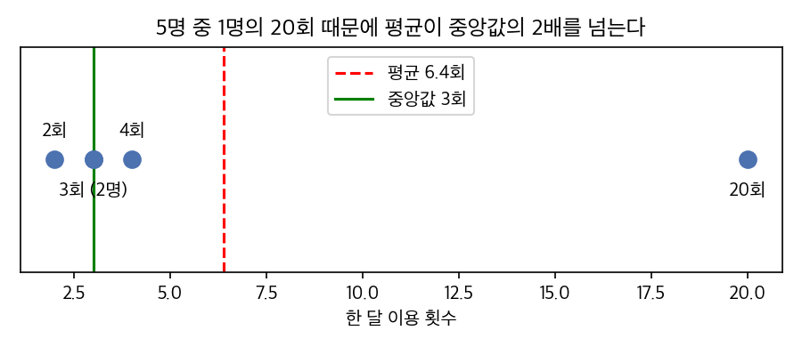

# AI를 활용한 통계 — 1회차 강의원고

2026년 12월 21일(월), 4시간 (50분 수업 + 10분 휴식, 4교시)

| 교시 | 주제 | 학습지 |
|---:|---|---|
| 1 | AI 도구 사용법과 현장 업무 흐름 | `practice/day1/1교시_도구와_업무흐름.md` |
| 2 | 설문문항 검토 | `practice/day1/2교시_설문문항_검토.md` |
| 3 | 평가 설문지 작성 | `practice/day1/3교시_평가설문지_작성.md` |
| 4 | 자료 정리, 빈도분석과 기술통계 | `practice/day1/4교시_빈도분석_기술통계.md` |

---

## 1교시. AI 도구 사용법과 현장 업무 흐름

### 1.1 AI에게 분석을 시키는 법 (20분)

ChatGPT, Copilot, Claude 같은 도구는 대규모 언어모델로 문장을 만든다. 대규모 언어모델은 앞에 나온 글 다음에 올 낱말을 확률로 골라 문장을 이어 쓰는 프로그램이다. 그래서 「평균은 2.8점」이라는 문장만 보고는 실제로 계산한 값인지 알 수 없다.

이 수업은 AI에게 숫자를 말로 묻지 않는다. AI가 Python 코드를 쓰고 실행하게 한 뒤, 실행 기록(로그)에 찍힌 숫자만 쓴다. 실습 폴더에는 이 규칙을 적은 `AGENTS.md`와 실행 기록을 남기는 도구가 미리 들어 있다. 이 묶음을 하네스라고 부른다.

| 학생이 할 일 | 방법 |
|---|---|
| AI에게 분석 시키기 | Copilot은 채팅 창 아래 모드를 에이전트(Agent)로 고른다. Claude Code는 처음부터 에이전트로 동작한다. 한국어로 무엇을 계산할지 적는다 |
| 실행 허용하기 | AI가 명령을 실행하려 하면 허용 여부를 묻는다. 무엇을 실행하는지 읽고 허용한다 |
| 근거 확인하기 | AI의 답 끝에 적힌 `outputs/results/파일이름.log`를 열어 답의 숫자가 그대로 있는지 본다 |
| 전체 점검하기 | 「하네스 돌려서 확인해 줘」라고 시키고, 마지막 줄이 `HARNESS_PASS`인지 본다 |

요금: Copilot은 GitHub 계정으로 무료 플랜을 쓸 수 있고 한 달 사용량에 한도가 있다. Claude Code는 Claude Pro(월 20달러) 이상에서 쓸 수 있다. 이 수업은 구독 요금제만 쓰고, 프로그램이 AI를 호출할 때 쓰는 API(사용량만큼 내는 요금제)는 쓰지 않는다.

학습지 1~4번: 확장 설치(수업 전 30분에 마친 학생은 건너뜀), 로그인, 첫 질문과 근거 확인.

### 1.2 현장 업무 흐름 (30분)

사회복지 현장의 프로그램 업무는 다음 순서로 이어진다. 이 수업의 여덟 교시도 같은 순서다.

| 단계 | 하는 일 | 쓰는 통계 | 교시 |
|---|---|---|---|
| 기획 | 대상자의 욕구와 실태를 파악해 제안서의 사업 필요성을 쓴다 | 빈도분석, 기술통계, 집단 비교 | 1-4, 2-1 |
| 설문 설계 | 성과지표를 정하고 사전·사후 평가 설문을 만든다 | — | 1-2, 1-3 |
| 평가 | 사전·사후 자료로 변화를 확인한다 | 대응표본 t검정, 독립표본 t검정 | 2-2 |
| 보고 | 분석 목적·방법·결과·시사점·한계를 보고서로 쓴다 | — | 2-3 |
| 환류 | 결과로 다음 제안서와 프로그램·설문을 고친다 | — | 2-4 |

시나리오: ○○종합사회복지관은 내년도 공모사업에 「어르신 디지털 역량 강화 프로그램(스마트폰 교실, 8주)」 제안서를 낸다. 올해 지역 어르신 300명에게 욕구조사를 했고, 시범 운영한 스마트폰 교실의 참여자 40명과 대기자 36명에게 사전·사후 설문을 했다.

### 1.3 목적 → 성과지표 → 측정 문항

제안서의 평가 계획은 「무엇이 달라지면 성공인가」를 숫자로 정하는 데서 시작한다. 이 순서를 거꾸로 하면, 즉 설문 문항을 먼저 쓰면 측정하지 않은 성과를 나중에 보고할 수 없다.

| 단계 | 질문 | 스마트폰 교실의 예 |
|---|---|---|
| 사업 목적 | 무엇을 바꾸려 하나 | 어르신이 스마트폰으로 일상 업무를 혼자 처리한다 |
| 성과지표 | 무엇을 숫자로 보나 | 디지털 역량 점수(5문항 평균, 1~5점)의 사전 대비 사후 변화 |
| 측정 문항 | 어떻게 묻나 | 전화·문자, 사진, 카카오톡, 키오스크, 인터넷뱅킹을 「혼자 할 수 있는가」로 묻는 5문항 |
| 측정 시점 | 언제 묻나 | 첫 회기 전(사전), 마지막 회기 후(사후) |
| 비교 대상 | 무엇과 견주나 | 같은 참여자의 사전 점수, 같은 기간 대기자의 변화 |

만족도는 운영이 잘 되었는지를 보는 지표다. 만족도가 높아도 역량이 변하지 않았을 수 있으므로, 성과지표와 따로 측정한다.

학습지 5~6번: 연결표 작성, AI가 제안한 성과지표 판정.

---

## 2교시. 설문문항 검토

### 2.1 검토 기준 네 가지

| 기준 | 묻는 것 | 결함 예 | 고친 예 |
|---|---|---|---|
| 명확성 | 모든 응답자가 같은 뜻으로 읽는가 | 「복지관을 자주 이용하십니까?」 | 「지난 한 달 동안 몇 번 이용하셨습니까? ① 0회 ② 1~2회 ③ 3~4회 ④ 5회 이상」 |
| 중립성 | 특정 답으로 이끌지 않는가 | 「많은 어르신이 도움을 받은 교실에 만족하십니까?」 | 「교실에 얼마나 만족하십니까?」 |
| 이중질문 | 한 문항이 한 가지만 묻는가 | 「강사와 교재에 만족하십니까?」 | 강사, 교재를 두 문항으로 나눈다 |
| 응답척도 | 선택지가 빠짐없이·겹치지 않게·균형 있게 나뉘고 분석 목적에 맞는가 | 「① 매우 만족 ② 만족 ③ 약간 만족 ④ 불만족」 | 「① 매우 불만족 ② 불만족 ③ 보통 ④ 만족 ⑤ 매우 만족」 |

명확성에서 자주 걸리는 낱말: 「자주」, 「최근」, 「충분히」처럼 사람마다 기준이 다른 말, 「디지털 리터러시」 같은 전문용어, 「~하지 않는 것이 불편하지 않다」처럼 부정어가 둘 들어간 문장.

응답척도에서 확인할 것:

- 범주가 겹치지 않는가(65~70세와 70~75세는 70세가 겹친다)
- 빠진 범주가 없는가(65세 이상 대상인데 80세 이상 범주가 없으면 안 된다)
- 긍정과 부정 선택지의 수가 같은가
- 변화를 보려는 문항이 예·아니오 두 단계면, 「도움을 받아 할 수 있게 된」 사람의 변화가 보이지 않는다. 5단계로 묻는다

### 2.2 AI에게 문항 검토를 시킬 때

AI는 결함 유형을 잘 찾지만, 결함이 없는 문항까지 다시 쓰거나 이중질문을 고치면서 한쪽 내용을 지우는 경우가 있다. 그래서 다음 순서로 한다.

1. 학생이 먼저 혼자 진단한다.
2. AI에게 문항마다 결함 유형과 이유를 한 줄로 쓰게 하고, 결함이 없으면 「없음」으로 쓰게 한다.
3. 학생이 AI의 진단을 자기 진단과 비교해, 놓친 것과 과하게 고친 것을 표시한다.
4. 최종 문항은 학생이 정한다.

학습지: 결함 문항 10개 진단·수정.

---

## 3교시. 평가 설문지 작성

### 3.1 사전·사후 설문의 원칙

| 원칙 | 이유 |
|---|---|
| 사전과 사후에 같은 문항, 같은 척도 | 문항이나 척도가 바뀌면 점수 변화가 프로그램 때문인지 문항 때문인지 구별할 수 없다 |
| 익명 연결 코드 | 같은 사람의 사전·사후를 짝지어야 대응표본 분석(2회차 2교시)을 할 수 있다. 이름 대신 「태어난 달 2자리 + 전화번호 끝 2자리」처럼 본인만 아는 코드를 받는다 |
| 성과 문항은 5단계 | 작은 변화도 점수에 나타난다 |
| 만족도는 사후에만 | 사전에는 만족도를 물을 경험이 없다 |
| 응답자 정보는 분석에 쓸 것만 | 문항이 길면 어르신의 응답 부담이 늘고 무응답이 많아진다 |
| 대기자에게도 같은 설문 | 같은 기간 프로그램 없이 점수가 얼마나 변하는지 알아야, 참여자의 변화 가운데 프로그램과 관련된 몫을 가늠할 수 있다 |

### 3.2 실습 순서

1. `practice/설문지_틀.md`로 초안을 쓴다.
2. AI에게 2교시의 네 기준과 사전·사후 일치 여부를 검토시킨다(파일은 고치지 않게 한다).
3. 짝과 바꿔 결함을 하나 이상 찾아 준다.
4. 받아들인 수정만 반영하고 「수정 기록」 표에 적는다.

---

## 4교시. 자료 정리, 빈도분석과 기술통계

업무 질문: 「제안서의 사업 필요성에 지역 어르신의 디지털 이용 실태를 숫자로 적어야 한다. 욕구조사 300명의 결과를 어떻게 요약하나?」

### 4.1 자료 정리: 무응답 코드

설문 자료에서는 답하지 않은 칸에 9 같은 숫자를 넣어 두는 경우가 많다. 9를 숫자 그대로 두고 평균을 내면 평균이 올라간다.

어르신 5명의 응답이 4, 2, 9, 3, 5이면:

- 9를 그대로 둔 평균: (4 + 2 + 9 + 3 + 5) ÷ 5 = 4.6
- 9를 빼고 응답한 4명의 평균: (4 + 2 + 3 + 5) ÷ 4 = 3.5

AI에게 분석을 시킬 때는 「9는 무응답 코드다. 결측으로 바꾸고 몇 개를 바꿨는지 알려 줘」라고 적는다.

### 4.2 빈도분석과 분모

빈도분석은 범주마다 몇 명인지와 그 비율을 세는 분석이다(예: 가구형태별 인원과 %). 비율을 쓸 때는 분모가 전체 응답자인지, 그 문항에 답한 사람인지 밝힌다. 위 예에서 4점 이상(4점, 5점) 비율은 5명 기준 40%, 응답 4명 기준 50%다.

### 4.3 기술통계: 평균, 중앙값, 표준편차

| 통계 | 뜻 | 계산 예(2, 3, 3, 4, 20) |
|---|---|---|
| 평균 | 모든 값을 더해 개수로 나눈 값 | 32 ÷ 5 = 6.4 |
| 중앙값 | 크기순으로 줄 세웠을 때 가운데 값 | 3 |
| 표준편차 | 값들이 평균에서 평균적으로 얼마나 떨어져 있는지 | 값이 고르면 작고, 들쭉날쭉하면 크다 |

_강사가 Python으로 실행해 만든 그림(평균 6.4, 중앙값 3)_

한 사람의 20회 때문에 평균이 중앙값의 두 배를 넘는다. 이용 횟수·소득처럼 일부가 아주 큰 자료는 중앙값을 함께 쓴다.

### 4.4 5점 척도 평균 읽기

5점 척도 문항의 평균 2.4점은 「보통(3점)보다 조금 낮다」보다, 척도의 낱말로 읽는 편이 정확하다. 디지털 역량 척도에서 2점은 「도움이 많이 필요하다」, 3점은 「도움이 조금 필요하다」이므로 2.4점은 그 사이다. 평균과 함께 낮은 점수(예: 2.5점 미만)를 받은 사람이 몇 %인지도 적는다.

학습지: 무응답 정리, 빈도표, 문항별 기술통계, 제안서 문장 2개 쓰기.

---

## 참고문헌

Li, et al. (2025). Can learners navigate imperfect generative pedagogical chatbots? Learning @ Scale 2025. (보도자료: https://www.eurekalert.org/news-releases/1106876 — 논문 원문 서지사항 확인 필요)
