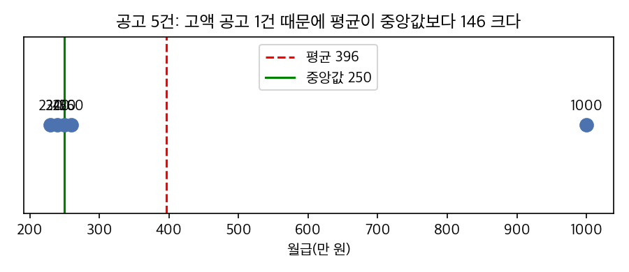

# AI를 활용한 통계 — 1회차 강의원고

2026년 12월 21일(월), 4시간 (50분 수업 + 10분 휴식, 4교시)

| 교시 | 주제 | 학습지 |
|---:|---|---|
| 1 | AI 활용 개요와 확장 설치 | `practice/day1/1교시_AI도구_시작하기.md` |
| 2 | 기록을 표로 정리하고 평균 읽기 | `practice/day1/2교시_기록정리와_평균.md` |
| 3 | 평균과 중앙값이 다른 경우 | `practice/day1/3교시_평균과_중앙값이_다른_경우.md` |
| 4 | AI가 틀린 곳 찾기 | `practice/day1/4교시_AI가_틀린곳_찾기.md` |

---

## 1교시. AI 활용 개요와 확장 설치

### 1.1 이 수업에서 하는 일

이 수업은 통계 이론이나 코딩을 가르치지 않는다. 직장에서 자주 받는 질문을 AI에게 한국어로 맡기고, AI가 낸 숫자가 맞는지 확인하는 방법을 배운다.

학생이 하는 일과 AI가 하는 일은 다음과 같이 나뉜다.

| 단계 | 누가 | 하는 일 |
|---|---|---|
| 질문 정하기 | 학생 | 무엇을 알고 싶은지 한 문장으로 정한다 |
| 예상하기 | 학생 | 작은 수치로 결과를 먼저 손으로 계산해 본다 |
| 코드 작성·실행 | AI | Python 코드를 쓰고 실행해 표와 그래프를 만든다 |
| 검증하기 | 학생 | 예상과 비교하고, 검증 3문항으로 점검한다 |
| 보고하기 | 학생 | 결론을 단정하지 않고 한계와 함께 쓴다 |

### 1.2 생성형 AI는 어떻게 답을 만드는가

ChatGPT, Copilot, Claude 같은 도구의 중심에는 대규모 언어모델(LLM, Large Language Model)이 있다. 대규모 언어모델은 많은 양의 글을 학습해, 앞에 나온 글 다음에 올 낱말을 확률로 골라 문장을 이어 쓴다.

이 방식에서 두 가지가 나온다.

- 문장은 자연스럽다. 질문의 뜻을 잘 알아듣고 한국어로 매끄럽게 답한다.
- 숫자는 틀릴 수 있다. 모델이 「평균은 4.1점」이라고 쓸 때, 실제로 계산했는지 그럴듯한 숫자를 이어 썼는지는 문장만 보고 구별할 수 없다.

그래서 이 수업은 AI에게 숫자를 말로 묻지 않는다. AI가 Python 코드를 쓰고 실제로 실행하게 하고, 실행 기록에 찍힌 숫자만 믿는다.

### 1.3 VS Code와 에이전트

VS Code는 마이크로소프트가 만든 무료 편집기다. 한 화면에서 세 가지를 함께 쓴다.

| 화면 영역 | 하는 일 |
|---|---|
| 왼쪽 탐색기 | 실습 폴더의 파일(데이터, 학습지, 결과)을 연다 |
| 가운데 편집기 | 파일 내용을 본다. 엑셀·PDF·한글 파일도 확장을 설치하면 여기서 열린다 |
| 오른쪽 채팅 | AI에게 한국어로 일을 시킨다 |

AI 도구에는 두 가지 사용 방식이 있다.

| 방식 | AI가 할 수 있는 일 | 이 수업에서 |
|---|---|---|
| 채팅(질문·답변) | 글로 답한다 | 개념을 물을 때 |
| 에이전트 | 파일을 읽고, 코드를 만들어 저장하고, 실행한다 | 분석할 때 |

Copilot은 채팅 창 아래에서 에이전트(Agent) 모드를 고른다. Claude Code는 처음부터 에이전트로 동작한다. 에이전트가 명령을 실행하려고 하면 허용할지 묻는다. 무엇을 실행하려는지 읽고 허용한다.

### 1.4 구독과 API

AI를 쓰는 요금 방식은 두 가지다.

| 방식 | 요금 | 쓰는 사람 | 이 수업 |
|---|---|---|---|
| 구독 | 월정액. 한 달 사용량에 한도가 있다 | 사람이 화면에서 직접 쓴다 | Copilot(무료·학생 플랜), Claude Pro(월 20달러) |
| API | 쓴 만큼 낸다(글자 수 단위) | 프로그램이 AI를 호출한다 | 쓰지 않는다 |

API(Application Programming Interface)는 프로그램끼리 주고받는 창구다. 회사에서 AI를 사내 시스템에 붙일 때 쓴다. 구독과 API는 별개의 상품이고 결제도 따로 한다. 이 수업은 구독만 쓴다.

### 1.5 바이브코딩

바이브코딩(vibe coding)은 코드를 직접 쓰지 않고 말로 지시해 AI가 코드를 만들게 하는 방식이다. 2025년 초부터 널리 쓰인 말이다.

바이브코딩을 하면 코드를 몰라도 분석을 시작할 수 있다. 대신 결과가 맞는지 판단하는 책임은 그대로 사람에게 남는다. 코드를 읽지 못하는 사람은 결과를 검증하는 방법을 알아야 한다. 이 수업의 나머지 시간은 그 방법을 다룬다.

### 1.6 하네스: 규칙을 주고 기록으로 확인한다

실습 폴더에는 AI가 작업 전에 읽는 규칙 파일과, AI의 말을 기록으로 확인하는 도구가 미리 들어 있다. 이 묶음을 하네스(harness)라고 부른다. 소프트웨어 분야에서는 코드를 실제로 돌려 결과가 기준에 맞는지 자동으로 확인하는 프로그램을 테스트 하네스라고 하고, 이 수업도 같은 뜻으로 쓴다.

| 층 | 파일 | 하는 일 |
|---|---|---|
| 1층 규칙 | `AGENTS.md` | 한국어로 답하기, 코드를 실행해 기록 남기기, 검증 3문항 적기 등 규칙을 AI에게 알린다 |
| 2층 기억 | `.ai/` 폴더 | 반복한 실수와 해결 기록을 남겨 같은 실수를 줄인다 |
| 3층 증거 | `scripts/run_and_capture.py`, `scripts/harness.py` | 실행 기록(로그)을 남기고, 기록이 지금 코드와 맞는지 검사한다 |

AI는 1층과 2층의 규칙을 어길 수 있다. 3층은 어겼는지를 판정한다. AI의 답 끝에 적힌 근거 로그(`outputs/results/파일이름.log`)를 열어 숫자가 그대로 있는지 확인하는 것이 이 수업의 기본 습관이다. 자세한 설명은 `harness.md`에 있다.

스킬(skill)은 특정 작업의 절차를 적어 둔 파일이다. PDF 변환, 한글(HWPX) 문서 변환 같은 스킬을 강사가 따로 배포하면 `.claude/skills/` 폴더에 넣는다. Copilot과 Claude Code가 이 폴더를 함께 읽는다.

### 1.7 수업의 실습 순서

모든 실습은 세 단계로 진행한다.

1. 예상하기: 5~10개의 작은 수치로 결과를 먼저 손으로 계산한다.
2. 시키기: 같은 질문을 실제 데이터로 AI에게 맡긴다.
3. 검증하기: AI의 결과를 예상과 비교하고 검증 3문항을 확인한다.

검증 3문항

1. 표본 수: 몇 명(몇 건)으로 계산했나? 빠진 값은 어떻게 처리했나?
2. 분모: 비율·평균을 무엇으로 나눴나?
3. 우연·다른 요인: 이 차이나 관계가 우연이거나 다른 이유 때문일 수 있나?

예상하기를 먼저 하는 이유가 있다. 입문 통계 챗봇을 쓴 대학생·성인 학습자 177명을 조사한 연구에서, 연구진이 일부러 넣은 오류를 학습자가 알아챈 비율은 약 15%였다(Li et al., 2025). 학습자는 답이 자기가 아는 것과 어긋날 때만 의심했다. 비교할 숫자를 먼저 갖고 있어야 AI의 오류가 보인다.

### 1.8 실습: 확장 설치와 첫 질문

학습지 `practice/day1/1교시_AI도구_시작하기.md`를 따라 한다.

- VS Code 권장 확장 9개 설치 (한국어 팩, 엑셀·워드·PDF·HWP 보기, CSV 보기, 표 데이터 탐색, Copilot, Claude Code, Python)
- Copilot 로그인(GitHub 계정), Claude Code 로그인(Claude Pro 가입자)
- 첫 질문과 근거 로그 확인, `HARNESS_PASS` 확인

---

## 2교시. 기록을 표로 정리하고 평균 읽기

업무 질문: 「우리 복지관 이용자 만족도가 평균 4.1점이다. 이건 좋은 점수인가?」

### 2.1 분석하기 좋은 표

현장의 기록은 사람이 읽기 좋게 적혀 있다. 컴퓨터가 계산하려면 다음 세 조건을 지킨 표가 필요하다.

| 조건 | 지키지 않은 예 | 지킨 예 |
|---|---|---|
| 한 행에 한 사람(한 건) | 같은 사람이 두 번 입력됨 | 중복 행을 하나만 남김 |
| 한 열에 한 가지 정보, 같은 형식 | 날짜가 2026-03-02, 2026.3.5, 3월 7일로 섞임 | 모두 2026-03-02 형식 |
| 같은 값은 같은 글자 | 「건강체조」와 「건강 체조」, 「5」와 「매우 만족」 | 한 가지 표기로 통일 |

정리 기준(「만족」을 몇 점으로 볼지, 「70대」와 「70대 이상」을 합칠지)은 AI가 정해 주지 않는다. AI에게 고친 목록을 보여 달라고 하고, 기준에 동의하는지 사람이 정한다.

### 2.2 평균, 중앙값, 분포

만족도 5명의 점수가 5, 5, 4, 4, 1점이다.

- 평균은 모든 값을 더해 개수로 나눈 값이다: (5 + 5 + 4 + 4 + 1) ÷ 5 = 3.8
- 중앙값은 크기순으로 줄 세웠을 때 가운데 값이다: 1, 4, 4, 5, 5 → 4
- 분포는 각 점수에 몇 명이 있는지다: 1점 1명, 4점 2명, 5점 2명

평균 3.8만 보고하면 1점을 준 사람이 있다는 사실을 알 수 없다. 만족도처럼 대부분이 높은 점수를 주는 조사에서는 낮은 점수를 준 사람이 몇 %인지 함께 본다. 점수별 인원을 막대그래프로 그리면 바로 보인다.

### 2.3 빈칸(결측)과 분모

설문에서 답하지 않은 칸을 결측이라고 한다. 결측은 0점이 아니라 「응답 없음」이다.

- 평균을 낼 때는 결측을 빼고, 몇 명을 뺐는지 적는다.
- 「불만이 ○%」라고 쓸 때 분모가 전체 인원인지, 응답한 인원인지 밝힌다. 둘은 다른 숫자가 나온다.

### 2.4 「좋은 점수인가」는 비교로 답한다

4.1점은 그 자체로 좋거나 나쁘지 않다. 비교 기준이 있어야 판단할 수 있다.

| 비교 기준 | 예 |
|---|---|
| 과거의 같은 조사 | 작년 평균 4.3점 |
| 같은 조사의 다른 집단 | 연령대별, 프로그램별 |
| 목표값 | 기관이 정한 목표 4.5점 |
| 다른 기관 | 같은 문항을 쓴 다른 복지관의 평균 |

### 2.5 실습

학습지 `practice/day1/2교시_기록정리와_평균.md`

- 실습 A: `data/이용자명부_원본.xlsx`를 분석하기 좋은 표로 정리
- 실습 B: `data/만족도조사.csv`의 평균·중앙값·분포를 구하고 작년(4.3점)과 비교

---

## 3교시. 평균과 중앙값이 다른 경우

업무 질문: 「사회복지 분야 채용공고의 평균 월급이 300만 원이라고 한다. 신입인 나도 300만 원 정도를 기대해도 될까?」

### 3.1 치우친 분포와 이상값

월급, 집값, 매출처럼 대부분은 비슷한데 일부가 아주 큰 자료가 많다. 이런 분포를 「오른쪽으로 꼬리가 긴(치우친) 분포」라고 하고, 다른 값보다 훨씬 큰 값을 이상값이라고 한다.

공고 5건의 월급이 230, 240, 250, 260, 1,000만 원이면 평균은 396만 원, 중앙값은 250만 원이다. 1,000만 원 한 건 때문에 평균이 중앙값보다 146만 원 크다. 5건 중 평균보다 많이 주는 공고는 1건뿐이다.

_강사가 Python으로 실행해 만든 그림(평균 396, 중앙값 250)_

### 3.2 무엇을 보고할까

| 상황 | 보고할 값 |
|---|---|
| 분포가 대체로 좌우 대칭 | 평균과 중앙값이 비슷하다. 평균을 써도 된다 |
| 한쪽으로 치우침(월급·매출 등) | 중앙값을 먼저 쓰고, 평균과 차이가 나는 이유(이상값)를 적는다 |
| 이상값이 다른 집단 | 그 집단을 따로 떼어 본다(예: 관리직 공고를 나눠 계산) |

### 3.3 그래프 고르기

| 그래프 | 잘 보이는 것 |
|---|---|
| 막대그래프 | 범주별 인원·평균(만족도 점수별 인원, 프로그램별 평균) |
| 히스토그램 | 숫자 자료가 어느 구간에 몰려 있는지, 꼬리가 어느 쪽으로 긴지 |
| 상자그림 | 중앙값, 가운데 50%가 있는 범위, 이상값 |
| 산점도 | 두 숫자의 관계(2회차) |

### 3.4 실습

학습지 `practice/day1/3교시_평균과_중앙값이_다른_경우.md`

- `data/채용공고_월급.csv`의 평균·중앙값·직무별 중앙값
- 히스토그램과 상자그림 비교

---

## 4교시. AI가 틀린 곳 찾기

### 4.1 AI의 답에서 자주 나오는 오류 다섯 가지

| 오류 | 모양 | 확인 질문 |
|---|---|---|
| 분모 | 「전체의 ○%」인데 전체에 빈칸 응답이 들어 있다 | 무엇으로 나눴나? |
| 평균만 봄 | 평균 하나로 「대부분이 그렇다」고 결론 낸다 | 중앙값과 분포는? |
| 빈칸 처리 | 빈칸을 0으로 넣어 평균을 낮춘다 | 빈칸을 어떻게 처리했나? |
| 상관을 인과로 | 같이 움직이는 두 값을 원인과 결과로 쓴다 | 다른 요인은 없나? 거꾸로일 수는 없나? |
| 표본 수 | 몇 명으로 낸 평균인지 밝히지 않고 순위를 매긴다 | 몇 명(몇 건)인가? |

다섯 가지 중 계산 자체를 틀리는 오류는 분모와 빈칸 처리다. 나머지 셋은 계산은 맞고 해석이 틀린다. 해석 오류는 코드를 다시 실행해도 드러나지 않으므로 검증 3문항으로 잡는다.

### 4.2 AI에게 되묻는 문장

| 의심이 들 때 | AI에게 할 말 |
|---|---|
| 숫자의 출처 | 「그 숫자가 근거 로그 어디에 있나? 해당 줄을 보여 줘.」 |
| 분모 | 「그 비율의 분모가 몇 명인지, 빈칸은 포함했는지 알려 줘.」 |
| 빈칸 | 「빈칸이 몇 개였고 어떻게 처리했는지 알려 줘.」 |
| 인과 | 「이 관계를 설명할 수 있는 다른 요인 3개를 말해 줘.」 |
| 표본 수 | 「각 집단이 몇 명인지 표에 함께 적어 줘.」 |

### 4.3 실습

학습지 `practice/day1/4교시_AI가_틀린곳_찾기.md` — 틀린 AI 답 5개에서 오류를 찾고 바른 답을 적는다.

---

## 참고문헌

Li, et al. (2025). Can learners navigate imperfect generative pedagogical chatbots? Learning @ Scale 2025. (보도자료: https://www.eurekalert.org/news-releases/1106876 — 논문 원문 서지사항 확인 필요)
