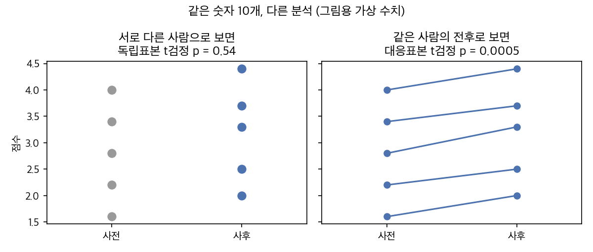

# AI를 활용한 통계 — 2회차 강의원고

2026년 12월 23일(수), 4시간 (50분 수업 + 10분 휴식, 4교시)

| 교시 | 주제 | 학습지 |
|---:|---|---|
| 1 | 독립된 두 집단 비교 | `practice/day2/1교시_독립_두집단_비교.md` |
| 2 | 같은 참여자의 사전·사후 비교 | `practice/day2/2교시_사전사후_비교.md` |
| 3 | 분석보고서 초안 작성 | `practice/day2/3교시_분석보고서_초안.md` |
| 4 | 상호 검토와 환류 | `practice/day2/4교시_상호검토와_환류.md` |

분석 실습은 1회차와 같이 예상하기 → 시키기 → 검증하기 순서로 한다. 검증할 때는 표본 수와 무응답 처리, 분모, 우연·다른 요인, 분석 방법이 자료 구조에 맞는지를 본다.

---

## 1교시. 독립된 두 집단 비교

업무 질문: 「제안서에서 독거 어르신을 우선 대상으로 삼으려 한다. 독거 어르신의 디지털 역량이 함께 사는 어르신보다 낮다고 쓸 수 있는가?」

### 1.1 차이가 우연일 수 있다

A동 어르신 3명의 점수가 2, 3, 4점(평균 3점), B동 3명이 3, 4, 5점(평균 4점)이면 평균 차이는 1점이다. 각 동에서 3명을 다시 뽑으면 차이가 달라진다. 인원이 적을수록, 사람마다 점수가 많이 다를수록 우연히 생기는 차이가 커진다.

### 1.2 p값

p값은 「실제로는 두 집단에 차이가 없는데, 표본을 뽑다 보니 우연히 이만큼 이상의 차이가 나올 확률」이다.

- 보통 0.05보다 작으면 「우연만으로는 잘 나오지 않는 차이」로 본다.
- p값으로 차이의 크기를 알 수 없다. 인원이 많으면 작은 차이도 p값이 작다. 그래서 보고서에는 평균 차이(점수)와 p값을 함께 쓴다.
- p값이 0.05보다 크다고 「차이가 없다」는 뜻은 아니다. 「이 자료로는 우연과 구별되지 않는다」는 뜻이다.

### 1.3 분석 방법 고르기

| 비교하려는 것 | 자료 | 분석 |
|---|---|---|
| 두 집단의 평균(예: 역량 점수) | 서로 다른 사람으로 이루어진 두 집단 | 독립표본 t검정 |
| 두 집단의 응답 비율(예: 참여 의향 있다·모르겠다·없다) | 범주 응답 | 교차표와 카이제곱 검정 |
| 같은 사람의 두 시점 평균 | 사전·사후 | 대응표본 t검정(2교시) |

교차표에서 「독거 어르신 중 참여 의향이 있다 ○%」라고 쓸 때 분모는 독거 어르신 전체다. 「참여 의향이 있다고 답한 사람 중 독거 ○%」와는 분모가 다르고 답하는 질문도 다르다.

### 1.4 차이를 원인으로 쓰지 않는다

독거 어르신의 역량이 낮게 나와도 「혼자 살아서 역량이 낮다」고 쓸 수는 없다. 독거 어르신 가운데 고령이거나 교육 기회가 적었던 분이 더 많을 수 있기 때문이다. 제안서에는 「독거 어르신의 평균이 ○점 낮았다」처럼 관찰한 차이만 쓴다. 여러 요인을 함께 고려하는 방법은 2교시 끝의 선택 시연(회귀분석)에서 보여 준다.

학습지: 독거·동거 역량 평균 비교, 교육 참여 의향 교차표, 제안서 문장 고르기.

---

## 2교시. 같은 참여자의 사전·사후 비교

업무 질문: 「시범 운영한 스마트폰 교실 참여자의 디지털 역량이 8주 뒤 올랐는가?」

### 2.1 독립표본과 대응표본

| 구분 | 자료 구조 | 예 | 분석 |
|---|---|---|---|
| 독립된 두 집단 | 두 집단이 서로 다른 사람 | 독거 대 동거 / 참여자의 변화량 대 대기자의 변화량 | 독립표본 t검정 |
| 같은 참여자의 전후 | 한 사람이 두 번 응답 | 참여자의 사전 대 같은 참여자의 사후 | 대응표본 t검정 |

대응표본 t검정은 사람마다 「사후 − 사전」 변화량을 구하고, 그 평균이 0과 다른지 본다.

같은 숫자 10개로 두 분석을 비교한 예다. 다섯 사람의 사전 점수는 1.6~4.0점으로 사람마다 크게 다르고, 다섯 사람 모두 0.3~0.5점씩 올랐다.

_강사가 Python으로 실행해 만든 그림(그림용 가상 수치, 독립 p 0.54, 대응 p 0.0005)_

독립표본으로 분석하면 사람 사이의 원래 점수 차이(1.6~4.0점)가 평균 변화 0.38점보다 훨씬 커서 p값이 0.54로 나온다. 대응표본으로 분석하면 각자의 변화만 보므로 p값이 0.0005다. 사전·사후 자료를 독립표본으로 분석하면 실제 변화를 놓칠 수 있다.

### 2.2 대기자와 비교한다

참여자의 점수가 올랐어도, 8주 동안 다른 이유(가족의 도움, 다른 교육, 같은 설문을 두 번 받아 익숙해진 것)로 올랐을 수 있다. 같은 기간 프로그램을 기다린 대기자의 변화가 있으면 참여자의 변화와 견줄 수 있다.

- 참여자의 변화량과 대기자의 변화량은 서로 다른 사람의 값이므로 독립표본 t검정으로 비교한다.
- 대기자를 무작위로 정하지 않았다면(예: 늦게 신청한 사람), 두 집단의 원래 특성이 다를 수 있다. 보고서의 한계에 적는다.

### 2.3 중도탈락자

중도탈락자는 사후 응답이 없어 대응표본 분석에서 빠진다. 프로그램이 맞지 않아 그만둔 사람이 빠지면 남은 사람의 결과가 실제보다 좋게 나올 수 있다. 보고서에는 중도탈락 인원과 그들의 출석 회차를 적는다.

### 2.4 (선택 시연, 10분) 회귀분석

회귀분석은 여러 요인을 함께 넣어 각 요인과 결과의 관계를 보는 방법이다. 강사가 욕구조사 자료로 시연한다. 독거 여부만 넣었을 때의 차이와, 연령·교육수준·스마트폰 보유를 함께 넣었을 때의 차이를 비교해 1교시 1.4절의 내용을 숫자로 확인한다. 학생 실습은 하지 않는다.

학습지: 사전·사후 대응표본 분석, 틀린 AI 답 찾기, 대기자 변화 비교, 중도탈락 확인.

---

## 3교시. 분석보고서 초안 작성

### 3.1 보고서 구성

틀은 `practice/분석보고서_틀.md`다.

| 절 | 쓰는 내용 |
|---|---|
| 1. 분석 목적 | 누가 무엇을 결정하려고 이 분석을 하는가(예: 내년도 제안서의 대상 선정과 성과 근거) |
| 2. 자료와 분석방법 | 조사 대상·인원·시기, 측정 도구, 무응답·중도탈락 처리, 쓴 분석과 고른 이유 |
| 3. 주요 결과 | 표·그래프와 결과 문장. 숫자에는 분모, 차이에는 점수와 p값 |
| 4. 시사점 | 결과를 근거로 무엇을 바꾸거나 유지할지 |
| 5. 한계 | 이 자료로 말할 수 없는 것 |
| 6. 제안서·프로그램 개선에 쓰기 | 다음 제안서 문장, 프로그램 개선안, 설문 개선안 |

### 3.2 결과 문장 쓰기

| 쓰지 않음 | 쓴다 |
|---|---|
| 프로그램이 디지털 역량을 향상시켰다 | 참여자 ○명의 역량은 사전 ○점에서 사후 ○점으로 ○점 올랐고(대응표본 t검정 p = ○), 같은 기간 대기자 ○명은 ○점 변했다 |
| 유의한 차이가 있었다 | 독거 어르신의 평균이 ○점 낮았다(독립표본 t검정 p = ○) |
| 만족도가 높아 성공적이었다 | 참여자 만족도는 평균 ○점(○명 응답)이었다 |

### 3.3 한계에 쓸 것

- 비교 집단: 대기자를 무작위로 정했는가
- 중도탈락: 몇 명이 빠졌고 결과에 어떤 영향을 줄 수 있는가
- 측정: 자기응답 설문이라 실제 사용 능력과 다를 수 있다
- 기간: 8주 뒤의 변화이며 그 뒤에도 유지되는지는 알 수 없다

학습지: AI에게 초안을 시키고, 숫자 5개를 로그와 대조하고, 시사점과 개선 문단을 직접 고친다.

---

## 4교시. 상호 검토와 환류

### 4.1 환류: 결과를 다음 단계로 옮기기

| 분석 결과 | 제안서에 쓰는 곳 | 프로그램 개선 | 설문 개선 |
|---|---|---|---|
| 욕구조사의 빈도·기술통계 | 사업 필요성(대상자의 실태와 욕구) | 어려워하는 기능에 회기 배정 | 응답이 한쪽에 몰린 문항의 척도 재검토 |
| 집단 비교(독거 대 동거) | 대상자 선정 기준 | 우선 모집 대상, 홍보 경로 | 비교에 필요한 응답자 정보 문항 유지 |
| 사전·사후와 대기자 비교 | 기대 성과(목표값), 평가 계획 | 변화가 작은 기능의 교육 방법 | 사전·사후 같은 문항 유지, 연결 코드 확인 |
| 중도탈락 | 평가 계획(탈락자 추적) | 탈락 시점의 회기 내용 점검 | 탈락 사유 문항 추가 |

### 4.2 평가 계획 문단에 들어갈 것

측정 시점(사전·사후), 측정 도구(문항과 척도), 비교 대상(같은 참여자의 사전, 대기자), 분석 방법(대응표본 t검정, 독립표본 t검정), 목표값(이번 결과를 근거로 정한 변화량).

### 4.3 수업 뒤에 혼자 쓸 때

| 항목 | 기억할 것 |
|---|---|
| 요금 | Copilot 무료 플랜은 한 달 사용량에 한도가 있다. 재학 중이면 Copilot Student를 신청한다. Claude Pro는 월 20달러이고 해지할 수 있다 |
| 개인정보 | 이용자 이름·주민등록번호·연락처·실제 설문 원자료는 외부 AI에 올리지 않는다 |
| 기관 규정 | 기관이 외부 AI 사용을 허용하는지 먼저 확인한다 |
| 검증 | 숫자는 근거 로그에서 확인하고, 분석 방법이 자료 구조에 맞는지 본다 |

학습지: 짝 보고서 검토, 환류 표 작성, 제안서 문단 초안.
