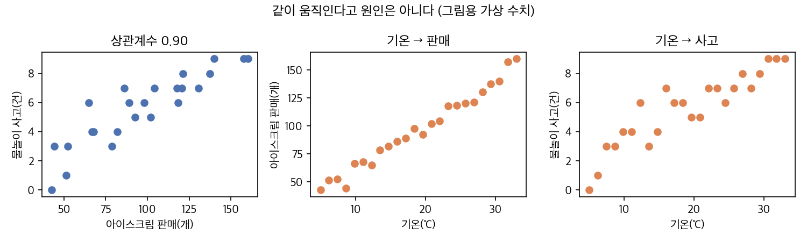

# AI를 활용한 통계 — 2회차 강의원고

2026년 12월 23일(수), 4시간 (50분 수업 + 10분 휴식, 4교시)

| 교시 | 주제 | 학습지 |
|---:|---|---|
| 1 | 집단 비교 | `practice/day2/1교시_집단비교.md` |
| 2 | 상관과 인과 | `practice/day2/2교시_상관과_인과.md` |
| 3 | 1페이지 리포트 작성 | `practice/day2/3교시_1페이지_리포트.md` |
| 4 | 공유와 상호 검증 | `practice/day2/4교시_공유와_상호검증.md` |

1회차의 실습 순서(예상하기 → 시키기 → 검증하기)와 검증 3문항(표본 수, 분모, 우연·다른 요인)을 그대로 쓴다.

---

## 1교시. 집단 비교

업무 질문: 「올해 집중 프로그램 참여자의 만족도가 미참여자보다 0.3점쯤 높다. 상사에게 "프로그램 효과가 있다"고 보고해도 될까?」

### 1.1 차이가 우연일 수 있다

A반 3명의 점수가 70, 80, 90점(평균 80점), B반 3명이 75, 85, 95점(평균 85점)이다. 평균 차이는 5점이다. 그런데 반마다 학생 3명을 다시 뽑으면 차이가 바뀐다. 사람 수가 적을수록, 사람마다 점수가 많이 다를수록 우연히 생기는 차이가 커진다.

그래서 두 집단을 비교할 때는 평균 차이와 함께 다음을 본다.

| 볼 것 | 이유 |
|---|---|
| 각 집단의 인원 | 인원이 적으면 차이가 우연히 크게 나올 수 있다 |
| p값 | 차이가 우연만으로 나올 가능성 |

### 1.2 p값 읽기

p값은 「실제로는 두 집단에 차이가 없는데, 표본을 뽑다 보니 우연히 이만큼 이상의 차이가 나올 확률」이다.

- 보통 0.05(5%)보다 작으면 「우연만으로는 잘 나오지 않는 차이」로 본다.
- p값이 작다고 차이가 크다는 뜻은 아니다. 인원이 많으면 작은 차이도 p값이 작게 나온다.
- p값이 작다고 원인이 밝혀지는 것도 아니다. 다음 절의 문제는 p값으로 해결되지 않는다.

AI에게 p값을 구하게 할 때는 「p값의 뜻을 쉬운 말로 함께 설명해 줘」라고 덧붙인다.

### 1.3 누가 참여를 정했나

프로그램에 스스로 신청한 사람과 신청하지 않은 사람은 처음부터 다를 수 있다. 예를 들어 복지관을 오래 다닌 사람이 프로그램에도 더 많이 신청하고, 원래 만족도도 높을 수 있다. 그러면 참여자의 만족도가 높은 이유가 프로그램 때문인지, 오래 다닌 사람이 많아서인지 구별되지 않는다.

이 문제를 줄이는 방법은 두 가지다.

| 방법 | 내용 | 언제 |
|---|---|---|
| 다른 요인을 함께 고려 | 이용기간처럼 두 집단이 다른 요인을 분석에 함께 넣어 차이가 얼마나 남는지 본다 | 이미 모은 자료를 분석할 때 |
| 무작위 배정 | 신청자 중 누가 먼저 참여할지를 추첨으로 정한다 | 사업을 설계할 때 |

함께 고려한 요인 말고도 측정하지 않은 요인이 남을 수 있다. 그래서 이미 모은 자료로는 「효과가 입증되었다」보다 「참여자의 만족도가 높았으나 ○○ 때문에 프로그램만의 효과라고 단정하기 어렵다」고 쓴다.

### 1.4 실습

학습지 `practice/day2/1교시_집단비교.md` — `data/만족도조사.csv`로 참여·미참여 비교, 이용기간을 함께 고려한 비교, 보고 문장 고르기

---

## 2교시. 상관과 인과

업무 질문: 「우리 카페는 광고비를 많이 쓴 달에 매출이 높았다. 광고비를 두 배로 늘리면 매출도 오를까?」

### 2.1 상관계수

상관계수는 두 숫자가 함께 오르내리는 정도를 -1에서 1 사이로 나타낸다.

| 값 | 뜻 |
|---|---|
| 1에 가까움 | 한쪽이 클 때 다른 쪽도 크다 |
| 0 근처 | 함께 움직이는 경향이 거의 없다 |
| -1에 가까움 | 한쪽이 클 때 다른 쪽은 작다 |

### 2.2 같이 움직인다고 원인은 아니다

여름에는 아이스크림 판매와 물놀이 사고가 함께 늘어난다. 두 숫자의 상관계수는 높다. 그러나 아이스크림이 사고를 일으키지 않는다. 기온이 오르면 두 숫자가 함께 늘어난다. 이렇게 두 숫자를 함께 움직이게 하는 요인을 세 번째 요인(교란 요인)이라고 한다.

_강사가 Python으로 실행해 만든 그림(그림용 가상 수치, 상관계수 0.90)_

상관을 인과로 읽기 전에 세 가지를 묻는다.

1. 두 숫자를 함께 움직이게 하는 다른 요인이 있는가? (예: 계절, 경기, 행사)
2. 원인과 결과가 거꾸로일 수는 없는가? (예: 매출이 오를 것 같은 달에 광고를 더 했다)
3. 우연일 수는 없는가? (자료가 몇 개인가)

### 2.3 회귀선과 기울기

회귀선은 산점도의 점들 사이를 가장 잘 지나가도록 그은 직선이다. 기울기는 「가로축 값이 1 클 때 세로축 값이 평균 얼마 큰가」를 뜻한다.

- 기울기는 자료에서 관찰된 관계다. 「광고비를 1만 원 늘리면 매출이 ○만 원 는다」는 원인의 크기가 아니다.
- 세 번째 요인을 회귀분석에 함께 넣으면, 그 요인이 같을 때의 기울기를 볼 수 있다. 기울기가 크게 바뀌면 처음 기울기의 상당 부분이 그 요인 때문이었다는 뜻이다.

### 2.4 교차표와 분모

교차표는 두 범주형 정보(예: 프로그램 참여 여부 × 재이용 의향)의 인원을 행과 열로 나눠 센 표다. 비율을 낼 때 분모를 무엇으로 하느냐에 따라 질문이 달라진다.

| 비율 | 분모 | 답하는 질문 |
|---|---|---|
| 행 비율 | 각 행의 합계(참여자 전체, 미참여자 전체) | 참여자 중 재이용 의향이 있는 사람은 몇 %인가? |
| 열 비율 | 각 열의 합계(「예」라고 답한 사람 전체) | 재이용 의향이 있는 사람 중 참여자는 몇 %인가? |

AI에게 교차표를 시킬 때는 「분모가 무엇인지 표마다 적어 줘」라고 덧붙인다.

### 2.5 실습

학습지 `practice/day2/2교시_상관과_인과.md` — `data/가게_월별매출.csv`로 상관계수와 회귀선, 성수기를 고려한 기울기, `data/만족도조사.csv`로 교차표

---

## 3교시. 1페이지 리포트 작성

### 3.1 리포트의 구성

틀은 `practice/report_template.md`다.

| 칸 | 쓰는 법 |
|---|---|
| 질문 | 한 문장. 읽는 사람이 무엇을 알게 되는지 |
| 표 1개 | 인원과 분모를 함께 적는다 |
| 그래프 1개 | 질문에 맞는 그래프 한 장(1회차 3교시 그래프 고르기 표) |
| 결론 3문장 | ① 가장 중요한 숫자와 그 뜻 ② 비교 기준과 견준 결과 ③ 제안(단정하지 않음) |
| 한계 1문장 | 자료로 말할 수 없는 것 |
| 근거 로그 | 리포트 숫자가 나온 `outputs/results/*.log` 경로 |

### 3.2 문장 고치기

AI가 쓴 초안에는 단정하는 표현이 자주 들어간다. 근거에 맞게 직접 고친다.

| AI 초안 | 고친 문장 |
|---|---|
| 프로그램이 만족도를 높였다 | 참여자의 만족도가 0.○점 높았다. 다만 참여자를 무작위로 정하지 않아 프로그램만의 효과라고 단정할 수 없다 |
| 대부분의 이용자가 만족한다 | 응답자 ○명 중 ○%가 4~5점을 주었고, ○%(○명)는 1~2점을 주었다 |
| 광고가 매출을 늘린다 | 광고비가 많은 달에 매출도 높았으나, 성수기를 고려하면 광고비와 매출의 관계는 뚜렷하지 않았다 |

### 3.3 실습

학습지 `practice/day2/3교시_1페이지_리포트.md` — 목적(재직·취업·창업)에 맞는 데이터 하나로 1페이지 리포트 작성

---

## 4교시. 공유와 상호 검증

### 4.1 짝 검증

짝의 리포트를 검증 3문항으로 점검하고, 숫자 3개를 골라 근거 로그에서 찾는다. 학습지 `practice/day2/4교시_공유와_상호검증.md`의 표를 쓴다.

### 4.2 수업 뒤에 혼자 쓸 때

| 항목 | 기억할 것 |
|---|---|
| 요금 | Copilot 무료 플랜은 한 달 사용량에 한도가 있다. 재학 중이면 Copilot Student를 신청한다. Claude Pro는 월 20달러이고 해지할 수 있다 |
| 개인정보 | 이용자 이름·주민등록번호·연락처, 회사의 인사·고객 자료는 외부 AI에 올리지 않는다 |
| 회사 규정 | 회사·기관이 외부 AI 사용을 허용하는지 먼저 확인한다 |
| 검증 | 숫자는 근거 로그에서 확인하고, 검증 3문항을 거친다 |
| 실습 폴더 | 수업 뒤에도 `ai_stats` 폴더를 그대로 쓸 수 있다. `AGENTS.md`의 규칙과 실행 기록이 계속 적용된다 |

### 4.3 두 회차에서 다룬 것

| 회차·교시 | 질문 | 확인한 것 |
|---|---|---|
| 1-2 | 만족도 4.1점은 좋은가 | 비교 기준, 분포, 빈칸과 분모 |
| 1-3 | 평균 월급을 믿어도 되나 | 치우친 분포, 중앙값 |
| 1-4 | AI 답의 오류 | 분모, 평균만 봄, 빈칸, 상관을 인과로, 표본 수 |
| 2-1 | 프로그램 효과가 있나 | p값, 누가 참여를 정했나 |
| 2-2 | 광고 덕분인가 | 세 번째 요인, 회귀 기울기, 교차표의 분모 |
| 2-3 | 1페이지 리포트 | 표·그래프·결론·한계 |
